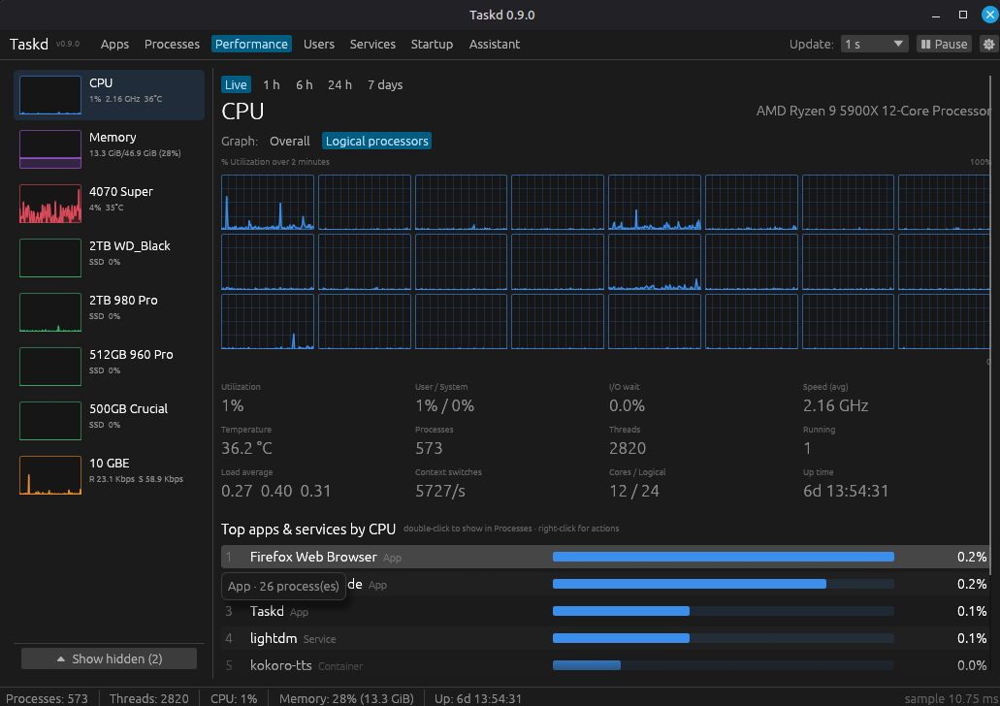
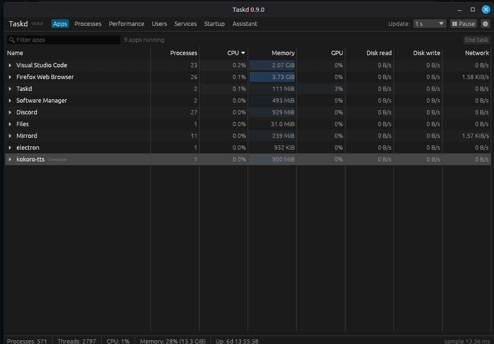

# Taskd



A fast, lightweight task manager for Linux. It's a single native binary that uses about 1% of one CPU core while open.

It shows your apps, processes, performance graphs (CPU, memory, disks, network, GPU, sensors), storage space, users, systemd services and startup apps, explains crashes and slowdowns, and can watch your other Linux machines over SSH. It can also act as an **MCP server**, so a local AI agent can look through your system for performance problems.

## Install

Paste this into a terminal. It needs no root and installs to `~/.local`:

```sh
curl -fsSL https://raw.githubusercontent.com/strid3r21/Taskd/main/install.sh | sh
```

It downloads the latest release for your CPU (x86_64 or ARM64), checks its signature and checksum, and adds Taskd to your app menu. You can [read the script](install.sh) first.

Or download a file from the [Releases page](https://github.com/strid3r21/Taskd/releases):

```sh
# Debian / Ubuntu / Mint / Raspberry Pi OS (use the _arm64.deb on ARM)
sudo apt install ./taskd-monitor_*_amd64.deb

# Arch Linux and derivatives: download PKGBUILD from the release, then
makepkg -si

# Any distro (installs to ~/.local, no root needed)
tar xzf taskd-monitor-*-linux.tar.gz && ./taskd-monitor-*/install.sh
```

Or build it from the git address with [Rust](https://rustup.rs). This installs only the command, with no app menu entry:

```sh
cargo install --locked --git https://github.com/strid3r21/Taskd
```

Then start **Taskd** from your app menu, or run `taskdm`.

> The package is named `taskd-monitor` and the command is `taskdm`, because Debian and Ubuntu already have an unrelated `taskd` package.

Taskd keeps itself up to date. Tarball installs update automatically at launch. `.deb` installs show an **Update & restart** banner, which asks for your password. Updates are **signed**: Taskd only installs a release whose checksums carry a valid signature from the project's release key. You can turn update checks off in the ⚙ menu.

## What's inside



| Tab | What you can do |
| --- | --- |
| **Apps** | See running apps, Docker/Podman containers and VMs with their processes grouped together. End, kill, suspend or resume a whole app; stop or restart a container; **limit an app's memory and CPU** (right-click → Limit resources). |
| **Processes** | See every process with CPU (plus a mini history graph and total CPU time), memory, GPU, disk, threads and state. Filter, sort, use tree view, change priority, send signals. Details show open files and network connections; **Find open file…** tells you which process is holding a file. |
| **Performance** | Live graphs for CPU (per core too, with each core's speed), memory, each disk, network interface, GPU and battery, plus the top 10 apps and services using each one. **Responsiveness** shows how much programs are *waiting* for the CPU, memory or disk, which is what you feel as lag. **Sensors** lists every temperature and fan sensor, plus CPU power draw and an estimate per app. Drag the sidebar to resize or reorder it; right-click an item to rename or hide it. |
| **Storage** | Free space on each drive, and **What's using space?**: a folder-by-folder breakdown you can click into, largest first. |
| **Users** | Resource use per user. Double-click a user to see their processes. |
| **Services** | Right-click a systemd service to start, stop, restart, reload, pause/resume, enable or disable it, see its processes and logs, or limit its memory and CPU. |
| **Startup** | Turn apps that launch at login on or off. |
| **Timeline** | *Why did it die?* Crashes, apps killed for running out of memory (by the kernel, a memory limit or systemd-oomd) and failed services, over the last day to 90 days. They're also marked on the history graphs. |
| **Machines** | Watch other Linux computers (a home server, a Raspberry Pi) in the same window over SSH: CPU, memory, responsiveness, temperatures, free space and their heaviest apps. Needs key-based SSH login and Taskd on the other machine; the **Install there** button can put it there for you. |
| **Assistant** | Ask an AI about your system ("why is it slow?"). Works with local models (Ollama, LM Studio) and with Claude, ChatGPT, DeepSeek, OpenRouter or any OpenAI-compatible API. It looks at live data through the same tools as the MCP server; ending processes is off unless you allow it, and every action asks first. Also from a terminal: `taskdm --ask "…"`. |

**History and alerts.** A small background recorder (a systemd user service, toggled in ⚙) keeps about a week of history. In the Performance tab, switch from **Live** to **1 h / 6 h / 24 h / 7 days** to see what happened while you were away; hover the graph to see which apps were running at that moment. The same recorder sends desktop **alerts** (low memory, CPU maxed out, the computer struggling, an app crashing or being killed for lack of memory, overheating, a saturated disk, heavy swapping, a failed service, low battery, or an app over a memory limit you set), configurable under ⚙ → Alerts. You can mute notifications for 1, 8 or 24 hours or until you turn them back on, from ⚙ or the tray icon.

**Per-app network usage** (plus disk I/O of system services and CPU power draw) is something Linux only shows to root. Turn on Taskd's optional helper under ⚙ → *Per-app network* (it asks for your password once). It's a small, sandboxed system service that reads only packet *headers* (the first 128 bytes, truncated in the kernel), attributes traffic to processes, and gives out nothing but per-process byte counts, and only to administrators.

**Tray icon** with a live CPU/memory graph; optionally keep Taskd running in the tray when you close the window (⚙).

**Automatic rules** (⚙ → Automatic rules, or right-click an app): always give an app low or high priority, or cap its memory or CPU. The background recorder applies them within seconds of the app starting. **Game mode** gives your other apps low priority while a game or launcher you list (e.g. Steam) is running.

**Keyboard shortcut:** set Ctrl+Shift+Esc (or Super+Esc) to open Taskd from ⚙ on Cinnamon, GNOME, KDE or Xfce. Launching Taskd again brings the open window to the front.

**Share what's going on:** ⚙ → *System report…* makes a summary of your machine, its current state, heaviest apps, storage, failed services and recent crashes, ready to paste into a bug report or forum post (it leaves out your computer's name, user names and command lines). The history view has **Export CSV**. From a terminal: `taskdm --report` and `taskdm --export-history 24h`.

Drag the top tabs to reorder them. The ⚙ menu has light/dark themes; window size and position are remembered.

**Keyboard:** `Ctrl+1`–`9` switch tabs · `Ctrl+F` search · `Delete` / `Shift+Delete` end / kill · `Enter` details · `Ctrl+P` pause · `F5` refresh

## Use it with a local AI agent (MCP)

[MCP](https://modelcontextprotocol.io) (Model Context Protocol) is a standard way for AI apps to use outside tools. Run `taskdm --mcp` and any MCP-capable AI app can ask Taskd about your system: what's using the CPU, why memory is full, which service failed, and so on. It runs on your machine, talks to the app over standard input/output, and opens no network port.

### 1. Find the path to `taskdm`

```sh
which taskdm
```

It's usually `/usr/bin/taskdm` (`.deb`) or `/home/YOU/.local/bin/taskdm` (tarball). Use the full path below, because desktop apps often don't search `~/.local/bin`.

### 2. Add Taskd to your AI app

Most MCP apps (LM Studio, Claude Desktop, Goose, Cursor, …) use the same configuration format. Add this to your app's MCP settings, usually a file called `mcp.json` or similar:

```json
{
  "mcpServers": {
    "taskd": {
      "command": "/usr/bin/taskdm",
      "args": ["--mcp"]
    }
  }
}
```

- **LM Studio:** open the **Program** tab in the right sidebar → **Install** → **Edit mcp.json**, paste the block above, and save.
- **Ollama:** Ollama itself doesn't load MCP servers. Use an MCP-capable front-end with it (for example Open WebUI or an Ollama MCP client) and give it the same command.

Pick a model that supports **tool calling**. Most recent Qwen, Llama 3.1+, Mistral and Gemma models do.

### 3. Ask it things

- "Why is my computer slow right now?"
- "What's using the most memory?"
- "Has anything been hogging the CPU over the last couple of minutes?"
- "Are any services failing? Show me their logs."
- "What is process 12345 and what started it?"

A good agent starts with `health_check`, then digs into the details.

### What the agent can see

| Tool | Gives the agent |
| --- | --- |
| `health_check` | A list of likely problems with severity and the apps responsible: CPU or memory pressure, swapping, slow disks, hot CPU/GPU, runaway processes, stuck processes, failed services |
| `system_overview` | CPU, memory, disks, network, GPUs, load and uptime |
| `top_consumers` | Top apps, services or processes by CPU, memory, GPU or disk |
| `list_processes` | Processes filtered by name, user or state |
| `process_details` | Everything about one process, including its parents and children |
| `resource_history` | How a resource has behaved over the last ~2 minutes |
| `failed_services`, `service_logs` | Failed systemd services and their recent log lines |
| `recent_events` | Crashes, out-of-memory kills and failed services from the journal (up to 30 days back) |

### Safety

The server is **read-only by default**. The agent can look but can't change anything.

To let it end processes or change priorities, add `"--mcp-allow-actions"` to `args`. Even then, Taskd refuses to touch the init process, kernel threads or itself, and it can't touch other users' processes unless it runs as root. Process command lines are shared with the agent (shortened); environment variables never are.

### Check that it works

```sh
printf '%s\n' '{"jsonrpc":"2.0","id":1,"method":"initialize","params":{"protocolVersion":"2025-06-18"}}' \
              '{"jsonrpc":"2.0","id":2,"method":"tools/list"}' | taskdm --mcp
```

You should see two JSON replies, the second listing the tools above.

## Performance

Taskd is built to stay out of your way:

- It reads `/proc` and `/sys` directly and keeps files open between updates. Collecting everything for ~590 processes takes about **3 ms**.
- It redraws only when new data arrives or you interact with it. The process table only draws visible rows.
- With the window open at a 1 s refresh it uses **~1% of one core** and **~33 MB** of private memory.

Measure it on your own machine with `taskdm --bench`.

## Building from source

```sh
cargo build --release
./target/release/taskdm
```

It needs no extra `-dev` packages: the windowing and GPU libraries are loaded at runtime. Before sending changes, run `cargo fmt --check && cargo clippy --all-targets -- -D warnings && cargo test`.

## License

MIT
